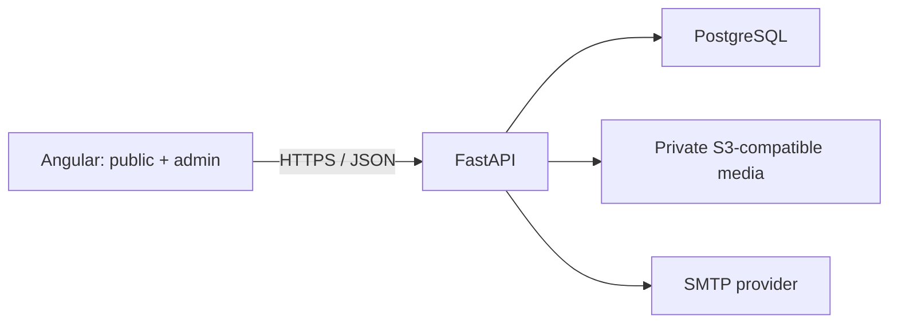

# Architecture

Juniper & Lane Realty uses a single Angular application for public and authenticated administration routes, backed by a FastAPI service. PostgreSQL owns relational records; object storage owns listing photos and documents.

## Request and data flow



The browser never receives database or storage credentials. Server-side dependencies enforce authentication, authorization, validation, and application rules; Angular guards are navigation aids, not a trust boundary.

## Application areas

**Public experience:** Search, filtering, sorting, pagination, listing detail, photo galleries, agents, open-house details, contact information, and optional map views.

**Customer accounts:** Email verification, authentication and recovery, saved homes and searches, recently viewed listings, inquiries, testimonials, and account settings.

**Internal application:** Dashboard, listing publication and media, leads, agents, offices, site settings, testimonials, analytics, CSV exports, and account/security administration.

Four roles define intended access:

| Role | Scope |
| --- | --- |
| `public_user` | Own customer-account workflows |
| `staff` | Authorized brokerage operations |
| `admin` | Brokerage administration and user/security management |
| `viewer` | Administrator-provisioned, read-only interactive demo |

The `viewer` role can inspect internal records, including potentially sensitive administrative data. It should only be offered on a demonstration environment containing appropriate data. All viewer mutations are rejected by FastAPI, independently of Angular.

## Data and media boundaries

- **Public listing eligibility:** Public queries apply publication and listing-status rules on the server, returning public-safe response models rather than internal records.
- **Search/pagination:** Search and filters are applied in SQLAlchemy before the database computes totals and page results.
- **Media lifecycle:** FastAPI validates uploads, produces optimized image variants, persists object keys and metadata, and attempts to clean up newly created objects if persistence fails. Reordering and primary-photo selection are explicit operations.
- **Customer isolation:** Authenticated customer operations revalidate the current user and public listing eligibility rather than trusting submitted IDs.
- **Lead management:** Public contact/showing submissions are recorded for staff workflows including status, assignment, and internal notes.
- **Mapping:** MapLibre/OpenFreeMap are requested on demand. Fictional demo properties use approximate city-area coordinates; hidden-address records withhold precise coordinates.

## Operational boundaries

- **Authentication:** Purpose-scoped JWTs with issuer, audience, and expiry. Internal accounts can use TOTP MFA and one-time recovery codes.
- **Schema management:** Alembic migrations are applied explicitly; application startup does not create tables.
- **Analytics:** Privacy-minimized first-party listing metrics feed the internal dashboard. On the configured live frontend, Cloudflare Web Analytics is initialized only when the analytics settings and visitor-consent decision permit it.
- **SEO:** Public page metadata, canonical URLs, JSON-LD, and a database-generated sitemap exclude private/admin and ineligible listing routes.
- **Availability:** `GET /health` checks database connectivity. Production compute is stateless; managed PostgreSQL and object storage persist independently.

## Production topology

```text
Browser -> Render Angular static site -> Render FastAPI Docker service
                                        |      |         |
                                   PostgreSQL  R2       SMTP
```

`render.yaml` defines the application services and references an existing paid Render database. CI-gated deployment, environment-injected frontend API origin, pre-deploy migrations, health checks, and custom HTTPS domains are configured there.

Related: [security](security.md), [accessibility](accessibility.md), and [production operations](production-deployment.md).
